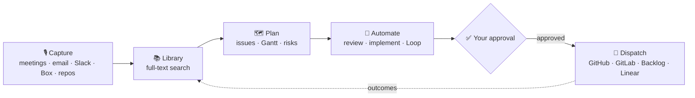
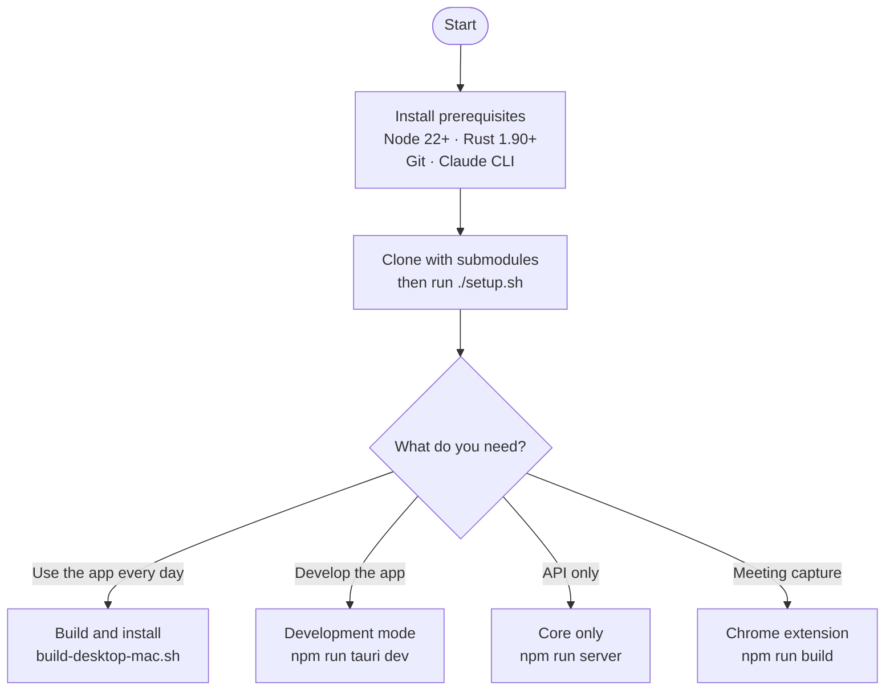
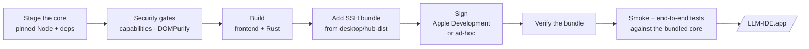
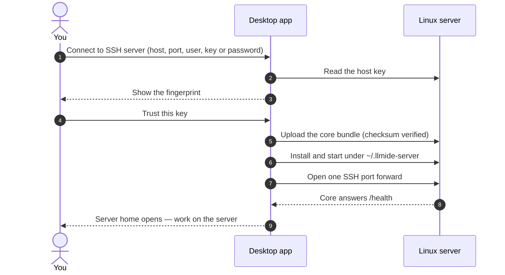
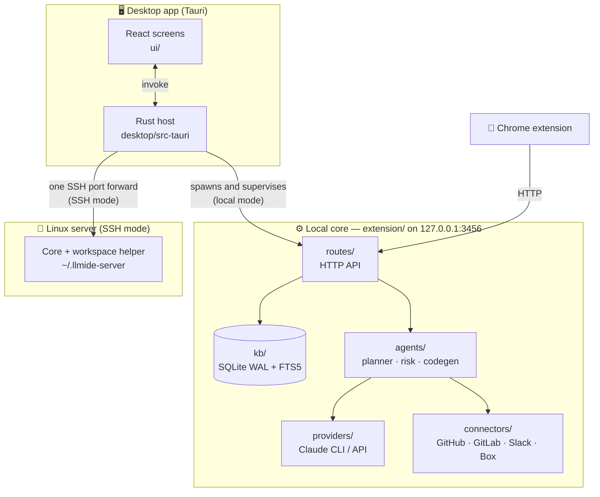
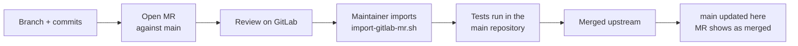
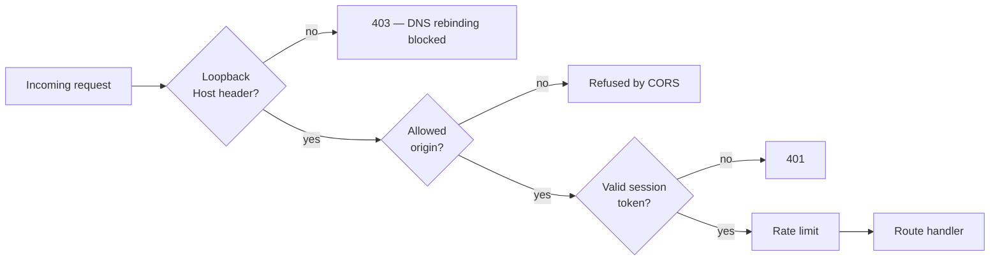

<div align="center">


# LLM-IDE

**A local-first AI workspace for engineering teams — desktop app, local core and Chrome extension.**


[Overview](#overview) ·
[Quick start](#quick-start) ·
[Install the app](#build-and-install-the-desktop-app) ·
[SSH server mode](#ssh-server-mode) ·
[Architecture](#architecture) ·
[Testing](#testing) ·
[Contributing](#contributing)

</div>

> **How this repository is maintained.** `main` is published automatically from the main LLM-IDE
> repository and cannot be pushed to directly. Contributions are welcome as merge requests — see
> [Contributing](#contributing).

## Overview

LLM-IDE captures meetings and other sources into a searchable library, turns them into plans and
tasks, and automates code review and implementation. Everything runs on your own machine, and
nothing leaves it until you approve an outbound action.



### What is in this repository

| | Component | Technology | What it does |
|:-:|:--|:--|:--|
| 🖥️ | **Desktop app** | Tauri 2 (Rust) + React, TypeScript | The main workspace: Library, Explorer with Code Assistant, Issues, Gantt, Graph, Auto Tasks, Loop and Settings |
| ⚙️ | **Local core** | Node.js 22, plain HTTP, SQLite | Auth, knowledge base, AI orchestration, guardrails and integrations on `127.0.0.1:3456` |
| 🔐 | **SSH server mode** | Rust host + Linux helper | Runs the core on a Linux server you can log in to, through one SSH port forward |
| 🧩 | **Chrome extension** | React 18, Manifest V3 | Captures live captions from Google Meet, Microsoft Teams and Zoom (web) |

Model calls use your signed-in **Claude CLI** by default; optional per-user API keys are kept in an
encrypted vault.

## Quick start



### Requirements

| Tool | Version | Notes |
|:--|:--|:--|
| Node.js | 22 or later | Core, extension and desktop front end |
| Rust | 1.90 or later | Desktop host; add the `x86_64-unknown-linux-musl` target for SSH mode |
| Git | any recent | Submodules are used |
| Claude CLI | latest | Sign in once with `claude login` |

On macOS, install the Xcode Command Line Tools. On Linux, install the
[Tauri system dependencies](https://v2.tauri.app/start/prerequisites/) for your distribution.

### Clone and set up

```bash
git clone --recurse-submodules git@gitlab.com:grid-devs/personal/dinesh/llm-ide-app.git
cd llm-ide-app
./setup.sh        # checks prerequisites and installs all dependencies; safe to re-run
```

If you cloned without `--recurse-submodules`, run `git submodule update --init --recursive graph-kit`
before `./setup.sh`. The `graph-kit` submodule (the graph engine) is public.

## Build and install the desktop app

```bash
rustup target add x86_64-unknown-linux-musl        # once; needed for the SSH server bundle
node desktop/scripts/stage-hub-core.mjs            # Linux server bundle for SSH mode -> desktop/hub-dist/
scripts/build-desktop-mac.sh                       # about 3 minutes warm; longer on the first run
ditto desktop/src-tauri/target/release/bundle/macos/LLM-IDE.app /Applications/LLM-IDE.app
open /Applications/LLM-IDE.app
```

What `build-desktop-mac.sh` does, step by step:



> [!IMPORTANT]
> The script does **not** install the app. Copy it to `/Applications` after every build, or you
> will keep running the old copy.

> [!TIP]
> Re-run `stage-hub-core.mjs` whenever you update the code: the build prints the date of the
> bundle it includes (`SSH bundle: … (staged …)`). Skip that step if you do not need SSH mode —
> the app still builds, and only SSH Connect is unavailable.

Add `--dmg` to also produce a disk image. On Windows and Linux, see
[Building on other platforms](#building-on-other-platforms).

### Development mode and other entry points

| Goal | Command | Result |
|:--|:--|:--|
| Develop the desktop app | `cd desktop && npm run tauri dev` | App window with live reload; starts its own core |
| Run the core only | `cd extension && npm run server` | API on `http://127.0.0.1:3456` (check `/health`) |
| Build the Chrome extension | `cd extension && npm run build` | `extension/dist/` to load in Chrome |

To load the extension, open `chrome://extensions`, turn on **Developer mode**, choose
**Load unpacked** and select `extension/dist/`. Keep the core running while you use it.

## SSH server mode

SSH server mode runs the LLM-IDE core on a Linux server and uses it from the desktop app on your
own computer — similar to VS Code Remote-SSH. The server needs no domain, TLS certificate, root
access, systemd or Node.js.



**Server requirements**

- Linux on x86_64 with at least 2 GB free in your home folder
- An SSH login: host, port, user, and a key file or password
- A POSIX login shell (bash, dash, zsh or ksh) and the `sha256sum`, `tar` and `setsid` commands
- glibc 2.34 or later (Ubuntu 22.04+, Debian 12+, RHEL 9+) for the standard bundle; older servers
  need the compat bundle (`stage-hub-core.mjs --compat-sqlite <module>`, see
  [desktop/PACKAGING.md](desktop/PACKAGING.md))
- Optional: the Claude CLI installed on the server and signed in, for AI features

**Connect:** choose **Connect to SSH server** on the Welcome screen, or open
**Settings → Server & Backend** and select **SSH server**. The host code lives in
`desktop/src-tauri/src/ssh_*.rs`; local and remote workspace logic is shared in
`desktop/workspace-core`.

## Architecture



**Design principles**

| Principle | How it is applied |
|:--|:--|
| Local-first | The core binds to `127.0.0.1`; one SQLite database per install |
| Small dependency surface | Plain Node HTTP, no web framework |
| Per-user tenancy | Every owned row carries a `user_id`; search hits are re-checked against it |
| Safe schema changes | Append-only, numbered SQL migrations in `extension/kb/migrations/` |
| Clear module boundaries | Import layers inside `extension/` are enforced by ESLint |

### Repository layout

```text
llm-ide-app/
├── desktop/               Tauri desktop app
│   ├── src-tauri/             Rust host: commands, core supervision, SSH mode
│   ├── workspace-core/        Shared local + SSH workspace logic
│   └── workspace-helper/      Linux helper serving Explorer file/git/search on SSH servers
├── ui/                    React screens and the shared UI kit
├── extension/             Local Node core (server.mjs, routes/, kb/, agents/, providers/)
│                          and the Chrome extension (src/)
├── schema/                Wire contracts (HTTP, Host API, sync) and fixtures
├── graph-kit/             Graph engine (git submodule)
├── deploy/hub/            Server templates used by the desktop's remote deployment
├── scripts/               Setup, build, code generation and verification
├── setup.sh               One-shot developer setup
└── Makefile               Test and lint entry points
```

## Testing

```bash
make test                       # core and extension tests (Node test runner)
make lint                       # ESLint + Prettier check for extension/
make test-desktop ALLOW_SKIP=1  # desktop + ui tests, then cargo tests when Rust is installed
make typecheck-desktop          # TypeScript check of the desktop and its screens
```

`ALLOW_SKIP=1` is required here because some upstream test targets cover parts that are not
mirrored (the web and iPhone apps).

## Contributing

Work in a branch and open a merge request (MR) against `main`. The maintainer imports approved MRs
into the main repository, where the full test suite runs; the change then comes back here
automatically and **your MR is marked as merged** — with your commits and authorship intact.



**Guidelines**

- **Start from the latest `main`.** Rebase your branch on `main` before asking for review; an MR
  based on an old `main` may need a rebase before it can be imported.
- **Keep the history linear.** Rebase instead of merging `main` into your branch — merge commits
  in an MR cannot be imported.
- **Stay inside the folders in this repository.** Adding new top-level files or folders is
  refused, even in an intermediate commit.
- **Build, CI and dependency files need maintainer approval.** Changes to `.github/`, `Makefile`,
  `setup.sh`, any `package.json` or `.gitattributes`, `deploy/hub/`, the `graph-kit` pin and the
  export scripts are imported only after an explicit maintainer decision — explain them in the MR.
- **Do not change `.gitmodules`.** Submodules are managed upstream.
- **Plain commits only.** GPG/SSH-signed commits and non-UTF-8 commit encodings
  (`i18n.commitEncoding`) cannot be re-created exactly; sign-off trailers (`Signed-off-by:`) are fine.
- **One topic per MR**, with [Conventional Commits](https://www.conventionalcommits.org/)
  subjects (`feat(ui): …`, `fix(server): …`, `docs: …`).
- **Run the tests** in [Testing](#testing) before requesting review.

## Security model



- **Loopback only.** The core listens on `127.0.0.1`; a remote bind must be enabled explicitly.
- **Secrets stay encrypted.** API keys and tokens live in an encrypted vault or the OS keychain.
- **Human approval.** Pull requests, tickets and messages are sent only after you approve them;
  generated diffs pass a guardrail scan first.
- **Verified SSH hosts.** SSH server mode pins the server's host key on first use.

## Building on other platforms

The release bundle embeds a staged copy of the core. **Always stage the core first**; otherwise
the build ships an outdated core.

```bash
cd desktop
node scripts/stage-core.mjs
npm run tauri build
```

These builds do not include the SSH server bundle; SSH mode then works only when the app runs from
the source checkout. Packaging, signing and platform notes:
[desktop/PACKAGING.md](desktop/PACKAGING.md) and [desktop/RUN-ON-MAC.md](desktop/RUN-ON-MAC.md).

## Troubleshooting

| Problem | Solution |
|:--|:--|
| `Cannot find module …` or other npm errors | Run `./setup.sh` again |
| `Node.js 22+ is required` | Install Node.js 22 or later |
| `cargo: command not found` | Install Rust from [rustup.rs](https://rustup.rs), open a new shell, run `./setup.sh` |
| `Port 3456 already in use` | Find the process with `lsof -i :3456`, stop it, then start the core again |
| `Could not load …/three.module.js` | `git submodule update --init --recursive graph-kit`, then `./setup.sh` |
| `install the target: rustup target add …` | Run `rustup target add x86_64-unknown-linux-musl` |
| SSH Connect: "This build does not include the server files" | Run `node desktop/scripts/stage-hub-core.mjs`, rebuild, copy the app again |
| The installed app does not show your latest changes | Rebuild and copy it to `/Applications` again — the build never installs |
| Extension does not load or is out of date | `cd extension && npm run build`, then reload it at `chrome://extensions` |

## Further reading

| Topic | Document |
|:--|:--|
| Desktop development | [desktop/README.md](desktop/README.md) |
| Packaging and releases | [desktop/PACKAGING.md](desktop/PACKAGING.md) |
| Building on macOS | [desktop/RUN-ON-MAC.md](desktop/RUN-ON-MAC.md) |
| Core internals, sync and invariants | [extension/CLAUDE.md](extension/CLAUDE.md) |

## License

Released under the [MIT License](LICENSE).
