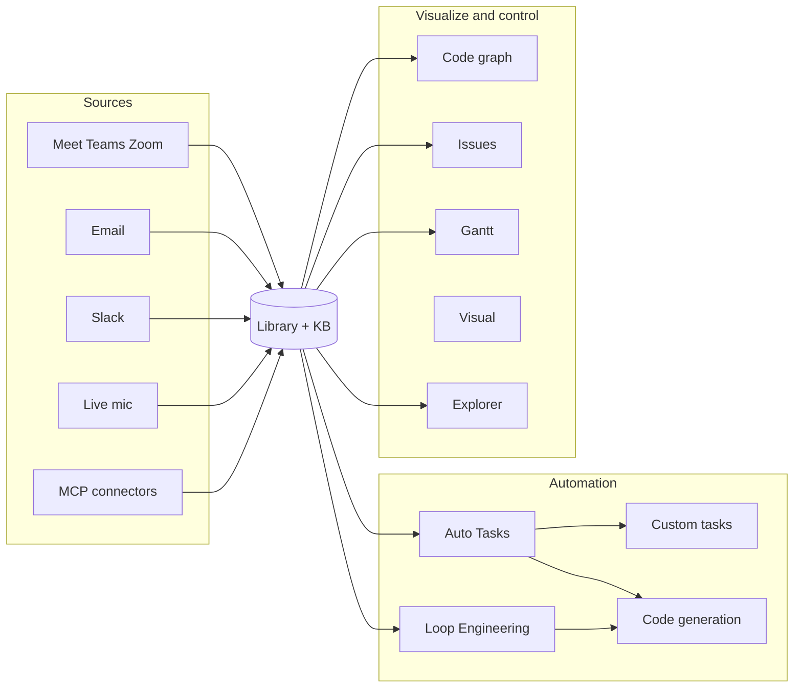
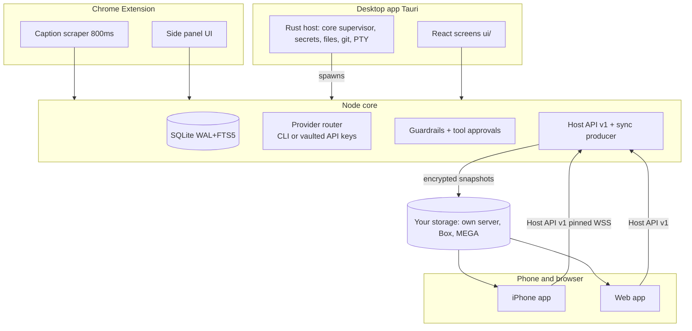

# LLM-IDE

> Local-first AI workspace — capture meetings and sources, plan in a searchable library, automate code review and implementation, and dispatch to GitHub/GitLab/tickets. Everything runs on `127.0.0.1` unless you approve an outbound action.

[](./extension/package.json)
[](./extension/server.mjs)
[](./extension/manifest.json)
[](#license)

## What this is

A **Chrome extension**, a **desktop app** (Tauri: macOS, Windows, Linux), a **web app**, an **iPhone app** and a **local Node core** that share one knowledge base and per-user SQLite store. Capture from meetings, email, Slack, and files; search and plan; run scheduled **Auto Tasks** (review, implement, regression, doc gen, **Loop Engineering**); visualize code and issues; dispatch work when you approve it.

**Local by default.** Data and AI orchestration stay on your machine. Optional per-user API keys (Claude, OpenAI, Google, OpenAI-compatible) live in an encrypted vault; when none are set, the server falls back to your logged-in **Claude CLI**. Outbound dispatch (PRs, tickets, Slack) is always opt-in.

## System at a glance

**Library is the hub.** Every source (meetings, email, Slack, Box, repos, MCP connectors) lands in the KB. From there you search, plan, automate, visualize, and dispatch — all on `127.0.0.1`.

<p align="center">
  
</p>

<p align="center">
  
</p>

| Pillar | What you get | Desktop | Extension | iPhone / web |
|--------|----------------|-----|-----------|--------|
| **Sources** | Meet · Teams · Zoom · live mic · **Email** · **Slack** · Box · **MCP** → notes in Library | ✅ full ingest | ✅ web CC capture | — |
| **Library** | Unified notes, code, data, plugins · FTS5 search · re-summarize | ✅ hub | ✅ meetings | — |
| **Automation** | **13 built-in Auto Tasks** + **custom tasks** (review/implement mode, per-task cron) · **Loop Engineering** | ✅ run + configure | — | ✅ monitor + run |
| **Code** | Explorer chat, codegen, workflows, guardrails, PR/ticket dispatch · **SCIP** symbol graph | ✅ | — | ✅ Explorer |
| **Visualize** | **Code graph**, **Issues**, **Gantt**, **Visual**, conflicts, **Loop Engineering** | ✅ | — | — |
| **Control** | Source control, search, live session, settings, mobile pairing | ✅ | side panel | companion |



**Built-in Auto Tasks (13, cron-schedulable on the desktop):**

| Pipeline | Tasks |
|----------|--------|
| Ingest → issues | Source Update · Sources → Issue · Implement Issues · Review & Merge |
| Review | Review Code · Review Doc · Review Conflicts · Regression |
| Generate | Knowledge · Generate Documentation |
| Maintain | Update Issues · Update Plan Status · **Loop** |

**Custom Auto Tasks** — create your own name + prompt; choose **Review** (discard edits) or **Implement** (commit on `fix/custom-*` branch); optional **cron** per task.

**Integrations (opt-in dispatch):** GitHub · GitLab · Backlog · Linear · Slack · **MCP-backed connectors** · **user plugins** (skills, slash commands, subagents).

## Architecture

The surfaces share one local core. All traffic stays on `127.0.0.1` unless you set `LLMIDE_ALLOW_REMOTE=1`.



| Surface | Role | Talks to |
|---------|------|----------|
| Chrome extension | Meet/Teams/Zoom web CC capture + side panel | the core on `127.0.0.1` |
| Node core (`extension/`) | Auth, KB, AI orchestration, persistence, connectors | — |
| Desktop app (`desktop/` + `ui/`) | Full KB, Explorer + Code Assistant, Issues, Gantt, Graph, Auto Tasks, Loop | spawns and supervises the core |
| Web app (`web/`) | Chat, history, approvals; offline reads from encrypted sync | Host API v1 or your sync storage |
| iPhone app (`ios_app/`) | Chat, history; offline reads from encrypted sync | Host API v1 or your sync storage |

**AI routing:** `extension/providers/` prefers each user's vaulted API key when present; otherwise shells out to the operator's Claude/Codex/Gemini CLI. See [ADR-0015](docs/decisions/0015-multi-provider-vaulted-api-keys.md).

**Tenancy:** JWT auth, per-user rows, HKDF-derived vault keys. FTS5 is shared; hydration queries are scoped by `user_id`.

Deep dive: [Architecture overview](docs/explanation/architecture.md) · [Server internals](docs/explanation/server-internals.md) · [Engineering invariants](docs/explanation/invariants.md) · [Project folder layout](docs/reference/project-layout.md) · [Naming convention](docs/decisions/0016-naming-convention.md)

### Naming

| Context | Form | Example |
|---------|------|---------|
| User-visible brand | **LLM-IDE** | menus, extension title, docs |
| Repo / package slug | **llm-ide** | `github.com/…/llm-ide`, npm package |
| Code identifiers | **LlmIde** | `LlmIdeAPIClient` |
| Wire / bundle | **llmide** | `com.llmide.desktop`, `llmide://` |

## Quick Start (3 Minutes)

```bash
git clone --recurse-submodules git@github.com:dnsmalla/llm-ide.git
cd llm-ide
./setup.sh                        # npm install, submodules (.skills + graph-kit), agent symlinks, git hooks
cd extension && npm run build     # extension/dist/ is gitignored — build before loading Chrome
cd extension && npm run server
```

Then load `extension/dist/` as an unpacked Chrome extension. Full tutorial: [Record your first meeting](docs/tutorials/01-first-meeting.md).

> Already cloned without `--recurse-submodules`? Run `./setup.sh` — it initializes both
> submodules (`.skills` and `graph-kit`). The desktop build and `make regression`'s graph
> gates read the graph-kit checkout, so keep it initialized.

---

## Complete Installation Guide (For Beginners)

### Prerequisites

- **macOS, Windows or Linux** for the desktop app (the iPhone app needs Xcode + a physical device)
- **Node.js 20+** — [Download](https://nodejs.org/)
- **Claude CLI** — [Install guide](https://docs.claude.com/en/docs/claude-code/quickstart) (`claude login`)
- **Git**
- **Rust** (stable, via rustup) — for the desktop app
- **Chrome** — for the extension
- **Xcode** (optional) — for the iPhone app and `make test-shared-protocol`

**Check what you have:**

```bash
node --version        # v20+
npm --version         # v10+
claude --version      # should work
git --version
cargo --version       # for the desktop app
```

### Step 1: Clone the Repository

```bash
git clone --recurse-submodules git@github.com:dnsmalla/llm-ide.git
cd llm-ide
ls -la   # docs/ extension/ desktop/ ui/ web/ ios_app/ graph-kit/ .skills/ setup.sh
```

### Step 2: Run Setup

```bash
./setup.sh
# ✅ Node.js, npm, backend deps (better-sqlite3)
# ✅ Claude CLI
# ✅ .skills submodule + agent symlinks (Claude / Cursor / Codex / …)
# ✅ git hooks (pre-push runs the gates for what changed)
```

If setup fails, see [Troubleshooting](#troubleshooting).

### Step 3: Build the Extension

```bash
cd extension && npm run build
# Writes extension/dist/ — required before loading in Chrome
```

### Step 4: Start the Node Server

```bash
cd extension && npm run server
# Server listening on http://127.0.0.1:3456
```

Keep this terminal running.

### Step 5: Load Chrome Extension

1. Open `chrome://extensions`
2. Enable **Developer mode**
3. **Load unpacked** → select `llm-ide/extension/dist/`
4. Pin the extension icon in the toolbar

### Step 6: Run the Desktop App

```bash
cd desktop && npm ci && npm run tauri dev
# release bundle: npm run tauri build (see desktop/PACKAGING.md)
```

The desktop app starts its own core; Settings → Features switches features off (applied on the next core start).

---

## Usage

### Chrome Extension
- Open Google Meet, Microsoft Teams, or Zoom (web)
- Extension captures **live captions** (not microphone audio)
- Side panel: notes, questions, entities, DOCX export

### Desktop App
- Full Library, Issues, Gantt, Graph, Explorer + Code Assistant, Live capture
- **Auto Tasks** page: built-in + custom tasks, cron schedules, Loop Engineering
- **Plugins**, **MCP connectors**, **SCIP ingestion** (`POST /kb/ingest-scip`)
- Settings → Phone and web sync: encrypted sync to your own server, Box or MEGA

### iPhone and Web
- Pair with the desktop (Settings → Phone and web sync, or Host API v1 pairing)
- Chat, history and approvals; offline reads from encrypted snapshots when the desktop is off
- See [ADR 0020](docs/decisions/0020-box-encrypted-sync.md)

### Server API
- REST on `http://127.0.0.1:3456` — used by the extension and the desktop app
- Wire protocol version tracked in `SERVER_API_VERSION` (`extension/server.mjs`, currently **39**)
- [API Reference](docs/reference/api/overview.md) · [OpenAPI spec](docs/reference/api/openapi.yaml)

---

## After Pulling New Code

```bash
git pull origin main
./setup.sh                    # deps, submodules, skills symlinks
cd extension && npm run build # refresh extension/dist if UI changed
cd extension && npm run server
```

See [FIRST_TIME_SETUP.md](FIRST_TIME_SETUP.md) for the post-pull checklist.

---

## Development Commands

```bash
# Terminal 1: Node server
cd extension && npm run server

# Terminal 2: Extension dev (hot reload)
cd extension && npm run dev

# Terminal 3: Desktop app
cd desktop && npm run tauri dev

# Tests
make test                  # extension (Node test runner)
make test-desktop          # desktop node checks + cargo test --lib
make test-shared-protocol  # iOS wire types (ios_app/SharedProtocol)
make regression            # pre-push gate (contracts, desktop/ui/web, agent/v2, graph-kit)

# Lint / docs
make lint && make format
make docs-serve            # localhost:8000
make docs-check            # links, frontmatter, API coverage
```

Central agent skills live in the [`.skills`](https://github.com/dnsmalla/agent-kit) submodule. Refresh after pull:

```bash
git submodule update --init --recursive .skills
bash scripts/install-skills.sh
cd extension && npm run sync:skills   # agent tool defs only
```

Agent/developer guide: [CLAUDE.md](CLAUDE.md)

---

## Troubleshooting

### ❌ "Cannot find module 'docx'" or other npm errors
```bash
./setup.sh
# or: rm -rf extension/node_modules && npm ci --prefix extension
```

### ❌ "node: command not found"
Install Node.js 20+ from https://nodejs.org/

### ❌ "claude: command not found"
Install and authenticate: https://docs.claude.com/en/docs/claude-code/quickstart → `claude login`

### ❌ "Port 3456 already in use"
```bash
lsof -i :3456 && kill -9 <PID>
cd extension && npm run server
```

### ❌ Chrome extension not updating
Run `cd extension && npm run build`, refresh on `chrome://extensions`, then hard-reload the meeting tab (Cmd+Shift+R).

### ❌ "Load unpacked" fails — no dist folder
`extension/dist/` is gitignored. Run `cd extension && npm run build` first.

### ❌ Settings/data lost after pull
Your data is safe — only code is pulled:
- Meetings/KB: `kb/` (gitignored per install)
- User settings: `~/.llmide/`

---

## Project Structure

```
llm-ide/
├── extension/          Chrome extension + Node server (:3456)
│   ├── server.mjs      HTTP entry (no framework)
│   ├── core/           Framework-free primitives
│   ├── server/         Routing, JWT, vault, rate limits
│   ├── kb/             SQLite + FTS5 + migrations (0001–0031)
│   ├── routes/         HTTP route modules
│   ├── providers/      Model dispatch (CLI shell-out + vaulted API keys)
│   ├── connectors/     GitHub, GitLab, Slack, Box, email, SCIP, MCP, …
│   ├── agents/         Planner, codegen, dispatch pipelines
│   ├── llm_agent/      Agent runtime + synced tool definitions
│   ├── graphkit/       Code-graph engine + memory writer
│   ├── guardrails/     Secret/PII/destructive-op scanners
│   ├── plugins/        Extension plugin loader/installer
│   ├── llm-sources/    LLM source registry (feeds kb/sources.mjs)
│   ├── mcp/            MCP server config + connector catalog
│   ├── src/            React side panel + content scripts
│   └── dist/           Built extension (load in Chrome; gitignored)
├── desktop/            Tauri desktop app (Rust host in src-tauri/)
├── ui/                 React screens + ui-kit shared by desktop and web
├── web/                Browser app (Host API v1 + encrypted sync)
├── graph-kit/          Graph engine submodule (separate repo)
├── ios_app/            iPhone app (SwiftUI + SharedProtocol)
├── .skills/            Central agent skills submodule
├── scripts/            setup helpers, contract generators, install-skills
├── docs/               MkDocs site (architecture, API, ADRs)
├── kb/                 Runtime SQLite (gitignored content)
├── setup.sh            One-shot install + skills wiring
└── CLAUDE.md           Agent/developer guide
```

Inside each **project**, LLM-IDE scaffolds `source/{meetings,emails,documents}/`, `llm-doc/`, `code/`, `system/`, etc. See [Project folder layout](docs/reference/project-layout.md).

---

## Documentation

📚 **Full docs site:** https://grid-devs.gitlab.io/personal/dinesh/notes-extension/

| Topic | Link |
|-------|------|
| Architecture | [docs/explanation/architecture.md](docs/explanation/architecture.md) |
| Server internals | [docs/explanation/server-internals.md](docs/explanation/server-internals.md) |
| Invariants (read before changing hot paths) | [docs/explanation/invariants.md](docs/explanation/invariants.md) |
| API overview | [docs/reference/api/overview.md](docs/reference/api/overview.md) |
| Project folder layout | [docs/reference/project-layout.md](docs/reference/project-layout.md) |
| Architecture decisions | [docs/decisions/](docs/decisions/) (ADRs 0001–0020) |
| Central skills install | [docs/how-to/install-central-skills.md](docs/how-to/install-central-skills.md) |
| Contribute | [docs/how-to/contribute.md](docs/how-to/contribute.md) |

---

## Next Steps

1. ✅ Setup done → [Record your first meeting](docs/tutorials/01-first-meeting.md)
2. Configure Auto Tasks → desktop app → **Auto Tasks** (built-in + custom)
3. Pair a phone or browser → desktop Settings → Phone and web sync
4. Understand the system → [Architecture overview](docs/explanation/architecture.md)

---

## License

MIT.
